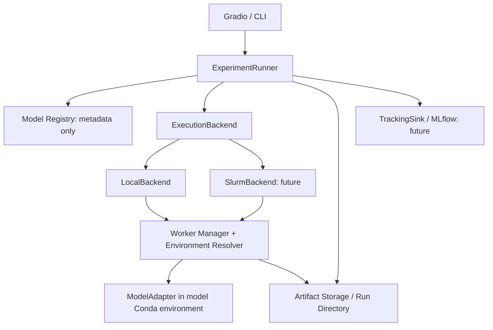

# MGE Experiment Platform

Repository: `gradio_mde`（[GitHub](https://github.com/Minoru-kuma/gradio_mde)）

本プロジェクトの正式名称は **MGE Experiment Platform** です。
MDE（Monocular Depth Estimation）を主要な構成要素として含む、
MGE（Monocular Geometry Estimation）/ MDE 向けの統合研究用実験基盤を目指します。
MDE は現在も中心的なユースケースであり、MoGe、UniK3D、Depth Anything V3 などを
共通の入力・出力・実行契約で実行、比較、評価できる構成を計画しています。
モデル追加時に UI や実験管理を書き換えず、モデル環境の依存競合も隔離することが目的です。

repository 名の `gradio_mde` は、当初の Gradio ベースの MDE 比較ツールの構想から
引き継いだ歴史的な名称として維持します。現在はその構想を再設計し、より一般的で拡張可能な
MGE / MDE 実験基盤へ発展させています。Gradio はシステムの UI / frontend の一つとして位置付け、
Local 実行、モデルごとの Conda 環境、将来の Slurm、MLflow Tracking、Benchmark を
独立した責務として組み合わせ、新モデルを共通インターフェースへ追加しやすい構成を目指します。

## 背景と目的

MoGe、UniK3D、Depth Anything V3 を個別に動作させた経験を出発点にします。
過去の Gradio と Slurm の同時開発で複雑化した経験を踏まえ、まず単一モデルの
Local 実行を成立させ、UI、複数モデル、Tracking、Benchmark、Slurm を順に追加します。

## 現在の開発状況

**2026-10-27: Phase 00 / 01 / 01A / 01B / 02A / 02B COMPLETE。Phase 02 は IN_PROGRESS、02C COMPLETE、02D は NOT_STARTED。**
Phase 02C の実装・検証・関連docs更新と、全Exit達成後のcommit / main通常pushが承認されています。
02D以降は未承認です。起動・環境・offline条件は [Gradio Inference](docs/gradio-inference.md) を参照してください。

調査対象の repository root では、文書作成前に空の `.git`、`.agents`、
`.codex`、`.aws` ディレクトリだけが見えました。ソース、依存定義、モデルスクリプトは
見えず、`git status` / `git log` は Git repository として認識されませんでした。
その後、ユーザーがこの repository 内に再利用必須の既存 production implementation はなく、
新しい実験基盤の clean-start repository として扱うことを正式に確認しました。
過去の MoGe / UniK3D / DA3 コードは repository の既存実装とは分け、
Phase 01 / Phase 03 の必要時に参考資料として確認します。

source audit gate と文書の exit criteria を再評価し、Phase 00 を COMPLETE としました。
01A の成果として CLI / Runner / LocalBackend / Conda worker / ModelAdapter / RunStore の
最小経路を実装し、独立環境 `mde-moge` と固定 checkpoint を準備しました。
ユーザーの CPU 選択に従い、MoGe-2 ViT-S Normal × sample 1枚 × LocalBackend の実推論が成功しました。
Run ID は `9c5b6556-30d3-43ae-827f-7bd8b0a47580`。raw depth は float32 `[256,256]` の
`z_depth / metric / m` で、metadata / WorkerResult / JobResult / stdout / stderr を保存・読み戻し済みです。
実測環境は Python 3.11.14、PyTorch 2.6.0+cu124、torch の CUDA runtime 12.4、device は CPU。
NVIDIA GPU は見えず `cuda_available=false` であり、GPU 実行・driver 互換性は未検証です。
依存導入後の fake / contract tests は8件成功（17.025秒）。depth の意味と実行経路の確認であり、精度評価は行っていません。
checkpoint / wheels / runs は Git 管理外です。固定版と実測証拠は [Phase 01](docs/phases/phase-01.md) に記録しています。
01B では cancel / execution timeout、Conda process group の停止、instance busy guard、
report / artifact 検証、区間計測、環境 fingerprint、保存済み terminal result の再 collect を追加しました。
固定環境を再作成し MoGe CPU regression smoke が成功。Run ID は
`f4a2052f-71da-4664-9c9f-281cca95fb41`。GPU / 精度評価は未検証です。
GradioのInference / Resultsを02Bで実装しました。02Cの3D viewerも全Exit達成でCOMPLETEです。Slurm、MLflow、Benchmark、他モデルは未着手です。
初回調査の根拠と clean-start 決定は [architecture](docs/architecture.md#repository-investigation) を参照してください。

## 対応予定モデル

| モデル | このプロジェクトでの対応状況 | 備考 |
| --- | --- | --- |
| MoGe | 01A CPU の single-image E2E を確認 | 固定した MoGe-2 ViT-S Normal。GPU / 他 variant は未検証。詳細・環境手順は [plugin README](models/moge/README.md) |
| UniK3D | 計画のみ | Phase 03。非 pinhole camera と rays の扱いを含む |
| Depth Anything V3 / Depth Anything 3（DA3） | 計画のみ | Phase 03。variant と single / multi-view の能力を分ける |

上記モデルをユーザーが過去に動作させたことと、この基盤が対応済みであることは別です。
upstream の公式情報と、このリポジトリ内の実測結果は分けて記録します。
詳細は [ModelAdapter spec](docs/model-adapter-spec.md) に記載しています。

## アーキテクチャ概要



図は将来拡張を含む概念図です。01A は CLI → Runner → LocalBackend → Conda worker → adapter のみ。
artifact の保存は worker / RunStore の責務で、ModelAdapter は Storage に依存しません。
Slurm の Worker Manager は将来、計算ノード側で環境を解決します。
Model は「何を」、Environment は「どの依存環境で」、Backend は「どこで」、
Tracking は「どう記録」、UI は「どう操作」を担当します。
UI は Registry / Runner / 公開 backend metadata を利用し、推論の submit は Runner に集約します。

## 概念的な利用手順

現在の最小実行手順は [MoGe plugin README](models/moge/README.md) を参照してください。
control process は stdlib のみで動き、torch / MoGe は別の Conda worker が import します。
今回確認した CPU 実行は以下です。device を明示して選択します。

```bash
PYTHONPATH=src python -m mde.cli run --model moge --input tests/assets/sample.png \
  --device cpu --checkpoint .local/weights/moge-2-vits-normal.pt
```

GPU が利用できる実行先では `--device cuda:0` を選択できますが、この機材では未検証です。
CLI の既定 device は `cuda:0`。CUDA が使えない場合は FAILED となり、CPU に自動切替しません。
`--run-root` → `MDE_RUN_ROOT` → project root の `./runs` の順に保存先を解決します。
入力は現在 PNG 1 枚、出力は raw depth / metadata / result / stdout / stderr です。
sample の出典・license は [tests/assets/README.md](tests/assets/README.md) に記録しています。

timeout は `--timeout-seconds 180` 等で指定できます。SIGINT / SIGTERM は worker group を停止し、
ユーザー cancel は CANCELLED（CLI exit 130）、timeout は FAILED / TIMEOUT（exit 1）です。
成功は exit 0、事前設定・未対応機能・integrity error は exit 2。同じ LocalBackend instance の
実行中の追加 submit は busy として拒否し、queue は作りません。保存済み結果は Conda 不要で再収集できます:

```bash
PYTHONPATH=src python -m mde.cli collect --run-id f4a2052f-71da-4664-9c9f-281cca95fb41
```

GPU 不要の contract tests（NumPy / Pillow を持つ独立モデル環境が必要）:

```bash
PYTHONPATH=src python -m unittest discover -s tests -v
# prefix 環境の場合は MDE_TEST_CONDA_PREFIX=/path/to/env を指定
```

以下は将来の UI / tracking / benchmark も含む概念的な手順です。

1. Registry から model / variant と capability を選び、backend と実行条件を選ぶ。
2. Runner が入力を Run Directory に保存し、Run ID と JobSpec を作る。
3. ExecutionBackend が JobSpec を受け取り、対象環境の worker を起動する。
4. worker が adapter の `load()` → `predict()` → `unload()` を実行する。
5. worker が共通 result と artifacts を保存し、Runner が `collect()` して検証する。
6. UI が capability と実際の結果に応じて表示する。Phase 04 以降は Runner が MLflow に記録する。
7. Phase 05 の Benchmark は同じ single inference を画像 × モデルで反復する。

ローカルの Run Root は設定で変更可能とし、既定候補はプロジェクトルート基準の
`./runs`、環境変数は `MDE_RUN_ROOT` です。研究室の NFS path は未確認です。

## ロードマップ

| フェーズ | 内容 | 状態 |
| --- | --- | --- |
| [00](docs/phases/phase-00.md) | Foundation / Architecture | COMPLETE |
| [01](docs/phases/phase-01.md) | 01A: Minimum Local E2E → 01B: Local robustness | COMPLETE。01A / 01B COMPLETE（CPU E2E / Local robustness） |
| [02](docs/phases/phase-02.md) | Geometry Artifacts / Gradio Inference / 3D Results / Run Management | IN_PROGRESS（02A / 02B COMPLETE、02C COMPLETE、02D未承認） |
| [03](docs/phases/phase-03.md) | Model Plugin Architecture / Multi-model | 未着手 |
| [04](docs/phases/phase-04.md) | MLflow Tracking | 未着手 |
| [05](docs/phases/phase-05.md) | Benchmark Mode | 未着手 |
| [06](docs/phases/phase-06.md) | Execution Backend Expansion / MockSlurm | 未着手 |
| [07](docs/phases/phase-07.md) | SlurmBackend Prototype | 研究室環境確認後 |
| [08](docs/phases/phase-08.md) | Real Slurm Integration Test | 研究室実機で検証 |

Phase の完了によって次 phase を自動開始しません。管理方法は [PLANS.md](PLANS.md) に定義します。
01A は 1 モデル・1 画像・1 独立 Conda 環境の subprocess worker を ModelAdapter / LocalBackend 経由で
実行し、共通 MDEOutput の raw depth、metadata / result / logs を Run Directory に保存する段階です。
cancel / timeout 等は 01B、GPU lease の必要性判断・高度な復旧 / concurrency は後段へ分けます。

## Phase 02 — Geometry / Gradio / 3D Results

[Phase 02](docs/phases/phase-02.md) は、1モデルのLocal推論と保存成果物を扱う
**Inference / Results の2タブ**を02Bで実装しました。内部milestoneの順序は次の通りです。

| Milestone | 役割 | 前提 |
| --- | --- | --- |
| [02A](docs/phases/phase-02/phase-02a.md) | 必須depthとoptional points / normals / intrinsicsの正式保存・検証（COMPLETE） | Phase 01 |
| [02B](docs/phases/phase-02/phase-02b.md) | GradioからRunnerを操作、入力・状態・cancel・busy・session分離（COMPLETE） | 02A |
| [02C](docs/phases/phase-02/phase-02c.md) | ResultsのDepth / RawDepth / Point Cloud / Mesh、派生mesh永続化（COMPLETE） | 02A・02B |
| [02D](docs/phases/phase-02/phase-02d.md) | Run履歴・管理情報・export・再生成・archive / restore・明示削除 | 02C |

Geometry artifactsは共通worker / RunStore、3D表示は共通viewer、管理操作は
[Run Management Service](docs/run-management-spec.md) に分離します。
モデル由来raw成果物と確定JobResultは不変、派生meshは遅延生成して別manifestに保存します。
表示切替・保存Runの再表示に再推論は行いません。optional出力は全モデルに強制しません。

ノートPC上のローカル起動を優先し、weights・モデル環境・application環境・frontend assetsを
事前準備すればオフライン利用できる構成を目指します。推論完了後はResultsへ結果を渡し、
保存Runは再起動後もRun IDから開ける計画です。CPUは明示選択、CUDAからの自動fallbackはありません。
Gradio / 3Dは固定環境で実CPU・browser検証済み。GPU / 学会デモは未検証です。
高度な検索・共有ユーザー管理・認証・お気に入り・高度な3D編集は範囲外です。

## Phase 02A Geometry Artifacts

従来CLIは既定depth-onlyのままです。optional geometryを明示要求できます。

```bash
PYTHONPATH=src python -m mde.cli run --model moge --input tests/assets/sample.png \
  --device cpu --checkpoint .local/weights/moge-2-vits-normal.pt \
  --outputs depth points normals intrinsics mask --timeout-seconds 300
```

ModelAdapterのnative出力をworkerが標準NPYへ保存し、RunStoreがsize / digest / shape / dtype /
frame / unit / validityとPoints-Depthの整合性を検証します。PointsはMoGeのnative推定点を使い、
`force_projection=False`で便宜的逆投影を避けます。Normals / Intrinsicsはnative提供時のみ対応。
maskはeffective validity、model_maskは元モデル判定として別保存します。
旧schema 1.0 / depth-only RunのcollectとCLI互換を維持し、raw / 確定JobResultを上書きしません。
実CPU native Pointsの保存・再読込・Depth整合と40 tests成功で02A COMPLETE。
実CPU結果・テスト・制限は [02A](docs/phases/phase-02/phase-02a.md) に記録します。
Gradioの起動方法は下記を参照してください。3D / derived meshは02Cで実装・検証済み、Run管理は02Dの未承認計画です。

## Phase 02B Gradio Inference

Gradio 6.30.0は独立application環境で動作し、既存Runner / LocalBackend / 独立model workerを利用します。
全browserが1つのBackendを共有し、busyなら即時拒否して推論をqueueに入れません。
input / parameters / handle / Resultsはsession別。status / cancelは非同期、progressはindeterminateです。
Resultsは検証済みJobResultの共通詳細とRun ID読込に加え、02Cの4モードviewerを提供します。

```bash
# Python 3.13.13を事前準備
python3.13 -m venv .local/envs/mde-ui
.local/envs/mde-ui/bin/python -m pip install -r requirements/ui.lock
PYTHONPATH=src .local/envs/mde-ui/bin/python -m mde.ui --model moge \
  --checkpoint .local/weights/moge-2-vits-normal.pt
```

`http://127.0.0.1:7860` でPNGをuploadし、deviceを明示選択します。CPU利用時は **cpu** を選びます。
CUDA要求の自動fallbackはありません。準備済みmodel環境 / weightsが必要です。
保存terminal結果だけなら `--read-only` でmodel環境なしに起動できます。
固定依存・offline再作成・制限・検証方法は [起動仕様](docs/gradio-inference.md)、
実測結果は [02B](docs/phases/phase-02/phase-02b.md) に記録します。

## Phase 02C 3D Results Viewer

ResultsのDisplay modeから **Depth / RawDepth / Point Cloud / Mesh** を選べます。
3D用の推論ではRequested artifactsで **points**（必要に応じnormals / intrinsics / mask）を明示要求してください。
保存Runの表示切替・再読込は再推論しません。旧depth-only RunはDepth / RawDepthを表示し、
3D情報が足りなければ理由を案内します。

Point CloudはRGB / Depth / native Normal色、MeshはRGB textured / Geometry / Wireframeに切替可能。
Meshは初回表示時に派生保存し、同条件では再利用します。raw / JobResultは不変です。
Three.js r180を同梱し、準備済み環境ではCDNなしのoffline操作を検証済み。
保存Runだけなら上記 `--read-only` 起動でモデル環境・weightsは不要です。

明示CPUのnative MoGeとfake / contract / browser / offlineの全Exitを達成し、02C COMPLETE。
固定Chrome / Linuxで262,144 output pixelsまで検証。GPU / 他OS/browser / 学会実演は未検証。
操作・保存schema・制限は [Results Viewer](docs/results-viewer.md)、実測結果は
[02C evidence](docs/phases/phase-02/phase-02c.md) を参照してください。02D以降は未承認です。

## ドキュメント一覧

- [AGENTS.md](AGENTS.md): Codex の作業ルール
- [PLANS.md](PLANS.md): phase の承認範囲・計画・進捗管理
- [Architecture](docs/architecture.md): 調査結果、責務、依存関係、設計判断
- [ModelAdapter spec](docs/model-adapter-spec.md): ModelInfo / Capabilities / MDEOutput
- [Results Viewer](docs/results-viewer.md): 02Cの4表示モード・mesh永続保存・固定版renderer・制限
- [Gradio Inference](docs/gradio-inference.md): 02B application環境・session / dispatch・offline起動
- [Environment strategy](docs/environment-strategy.md): Conda、CUDA、subprocess、micromamba
- [ExecutionBackend spec](docs/execution-backend-spec.md): Job / Resource / backend 契約
- [Slurm integration](docs/slurm-integration.md): 将来の接続方式と研究室確認事項
- [MLflow design](docs/mlflow-design.md): Params / Metrics / Artifacts / Tags
- [Run Directory spec](docs/run-directory-spec.md): file protocol、Run ID、attempt、保存形式
- [Run Management spec](docs/run-management-spec.md): Phase 02C / 02D の派生保存・管理service計画
- [Phase 00–08](docs/phases/): 各段階の tasks / tests / exit criteria
